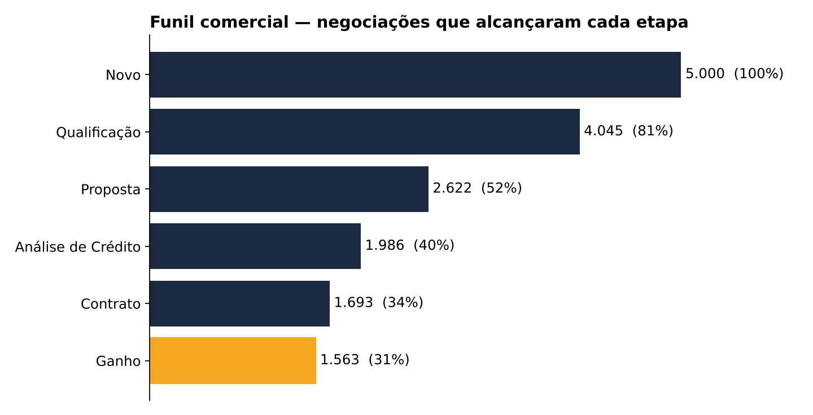
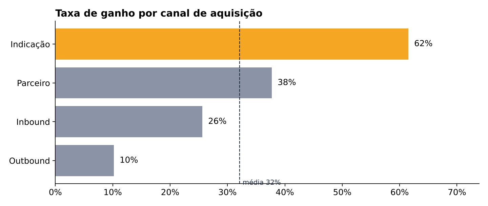
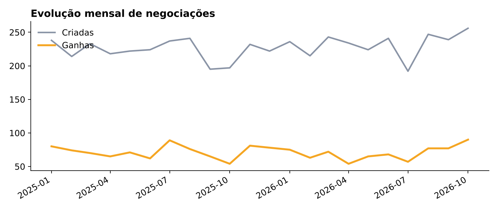
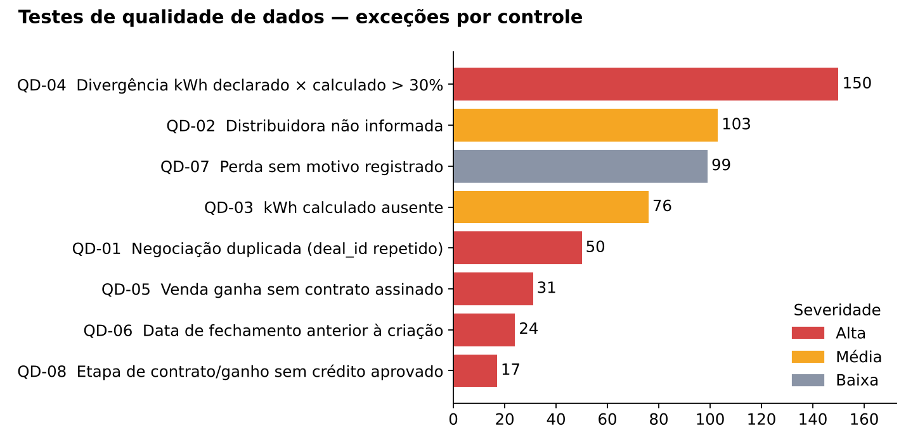
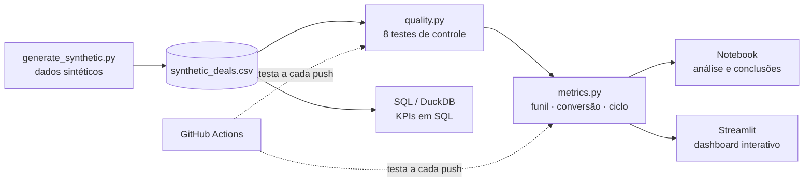

<h1 align="center">☀️ Funil Comercial de Geração Distribuída</h1>
<p align="center"><b>Analytics + Controles de Qualidade de Dados para um funil de vendas de energia solar compartilhada</b></p>

<p align="center">
  
  
  
  
  
  
</p>

> **Dados 100% sintéticos.** A empresa *Helios GD* é fictícia. Nenhum dado real de clientes ou de empresas foi utilizado — a base é gerada por script com seed fixa, o que torna toda a análise reprodutível.

---

## 🎯 Problema de negócio

Uma comercializadora de Geração Distribuída (GD) vende créditos de energia solar para consumidores conectados a diferentes distribuidoras. A diretoria precisa saber:

1. **Onde o funil perde mais negociações?**
2. **Quais canais de aquisição merecem mais investimento?**
3. **Os dados do CRM são confiáveis o suficiente para sustentar essas decisões?**

## 📌 Principais resultados

| | Achado | Recomendação |
|---|---|---|
| 🟠 | **Indicação converte 62%**, quase 2x a média (32%) | Estruturar programa de indicação |
| 🔴 | **Outbound converte apenas 10%** | Rever perfil de cliente-alvo antes de escalar |
| 🟡 | Maior queda do funil: **Qualificação → Proposta (65%)** | Revisar critério de qualificação e SLA de proposta |
| 🛡️ | **8 testes de controle** aplicados a 100% da base, com exceções em todos | Travas preventivas no CRM (campos obrigatórios, bloqueio de etapa) |

## 📊 Visualizações

<p align="center"></p>
<p align="center"></p>
<p align="center"></p>

## 🛡️ Controles de qualidade de dados

Antes de calcular qualquer KPI, a base passa por testes no estilo de auditoria (população completa, não amostra). Cada teste tem código, severidade e lista de exceções rastreável.

| Código | Teste | Severidade |
|---|---|---|
| QD-01 | Negociação duplicada | Alta |
| QD-02 | Distribuidora não informada | Média |
| QD-03 | kWh calculado ausente | Média |
| QD-04 | Divergência kWh declarado × calculado > 30% | Alta |
| QD-05 | Venda ganha sem contrato assinado | Alta |
| QD-06 | Data de fechamento anterior à criação | Alta |
| QD-07 | Perda sem motivo registrado | Baixa |
| QD-08 | Contrato/ganho sem crédito aprovado | Alta |

<p align="center"></p>

## 🏗️ Arquitetura



## 🗂️ Estrutura

```
├── app/streamlit_app.py        # dashboard interativo (filtros, KPIs, exceções)
├── data/
│   ├── generate_synthetic.py   # gerador reprodutível (seed fixa)
│   └── synthetic_deals.csv
├── notebooks/analise_funil.ipynb
├── scripts/build_figures.py    # gera os gráficos deste README
├── sql/kpis.sql                # mesmos KPIs em SQL
├── src/funnel/
│   ├── metrics.py              # funil, taxa de ganho, ciclo, evolução
│   └── quality.py              # matriz de testes de controle
└── tests/test_funnel.py        # pytest (rodando no CI)
```

## ▶️ Como executar

```bash
git clone https://github.com/thiago3636/gd-sales-funnel-analytics.git
cd gd-sales-funnel-analytics
pip install -r requirements.txt

python data/generate_synthetic.py      # regera a base
pytest -q                              # roda os testes
streamlit run app/streamlit_app.py     # abre o dashboard
```

## 🧰 Stack

`Python` · `pandas` · `NumPy` · `Matplotlib` · `Plotly` · `Streamlit` · `DuckDB/SQL` · `pytest` · `GitHub Actions`

## 🔜 Próximos passos

- [ ] Publicar o dashboard no Streamlit Community Cloud
- [ ] Modelo de propensão de ganho (regressão logística)
- [ ] Análise de coorte por mês de criação

---

<p align="center">
Feito por <b>Thiago Rodrigues</b> · Estudante de Gestão de TI · Análise de Dados para Inteligência Comercial<br>
<a href="https://www.linkedin.com/in/thiago-rodrigues-30b54717b/">LinkedIn</a>
</p>
